 

## 🧭 About Me

Hey, I'm **Suneel Bose K** 👋 — a **Geospatial Engineer** and **Full-Stack Developer** from Tamil Nadu, India, building at **ArcGX TechLabs**.

I love turning **maps, sensors and city data** into software people can actually use: real-time spatial pipelines, local-first vector search, and tools that make Python workflows visible.

🛰️ &nbsp;Currently crafting **AI-native GIS formats** and **quantum-inspired spatial intelligence** for Python.

🎓 &nbsp;B.Tech from **Bharathidasan University** — where I built **EcoSpatial**, a geospatial decision support system for urban environmental risk.

💬 &nbsp;Ask me about **GIS, H3 hexagons, PostGIS, FAISS, RAG, Next.js** — or anything spatial.

 

 

<table>
<tr>
<td width="50%" valign="top">

### 🔭 What I do
- 🗺️ Design **geospatial data pipelines** that turn raw city signals into decisions
- 🧠 Build **local-first vector databases** and semantic search for RAG
- ⚙️ Ship **developer tools** that make Python pipelines observable
- 🌐 Craft **full-stack web apps** with TypeScript, React and Next.js

</td>
<td width="50%" valign="top">

### 🌱 Right now
- 🛰️ **GeoForge** — an AI-native GIS vector format (`.geof`)
- ⚛️ **QoreGeo** — quantum-powered spatial intelligence for Python
- 📡 **Urban Signal Fusion** — real-time City Stress Index for smart cities
- 🔐 **VecForge** — encrypted, multimodal, offline vector DB

</td>
</tr>
</table>

## 🛠️ Tech Stack

**Languages**

**Frontend & Frameworks**

**Data, Geo & Infra**

 

## 🚀 Featured Projects

 

| Project | What it is | Stack | Links |
|:--|:--|:--|:--|
| 🏙️ **Urban Signal Fusion** | High-performance geospatial pipeline that captures real-time city rhythms, computes a **City Stress Index (CSI)** and flags urban anomalies instantly. | Python · H3 · Real-time | [Repo](https://github.com/bosekarmegam/urban-signal-fusion) · [Live](https://urban-signal-fusion.vercel.app) |
| 🔐 **VecForge** | Universal, local-first Python vector database with AES-256 / SQLCipher security, RBAC, multimodal ingestion, hybrid search and optional quantum-inspired acceleration. | Python · FAISS · RAG | [Repo](https://github.com/bosekarmegam/vecforge) · [Docs](https://bosekarmegam.github.io/vecforge/) |
| 👁️ **StepCast** | Make Python scripts visible: wrap any function in a named step and watch it run live with label, output, timing and pass/fail. Zero dependencies. | Python · PyPI · DevTools | [Repo](https://github.com/bosekarmegam/stepcast) · [Docs](https://bosekarmegam.github.io/stepcast/) |
| ⚛️ **QoreGeo** | Quantum-powered spatial intelligence for Python. Zero dependencies. | Python | [Repo](https://github.com/bosekarmegam/qoregeo) |
| 🧬 **GeoForge** | The AI-native GIS vector format (`.geof`), designed to replace Shapefile, GeoJSON, KML and GeoPackage. | GIS · File formats | [Repo](https://github.com/bosekarmegam/geoforge) |
| 🌿 **EcoSpatial DSS** | Geospatial Decision Support System for urban environmental risk assessment (academic project, Bharathidasan University). | TypeScript · GIS | [Live](https://ecospatial.vercel.app) |

## 📊 GitHub Analytics

  

## 🐍 Contribution Snake

<picture>
  <source media="(prefers-color-scheme: dark)" srcset="https://raw.githubusercontent.com/bosekarmegam/bosekarmegam/output/github-snake-dark.svg"/>
  <source media="(prefers-color-scheme: light)" srcset="https://raw.githubusercontent.com/bosekarmegam/bosekarmegam/output/github-snake.svg"/>
  
</picture>

## 🤝 Let's Connect

 

